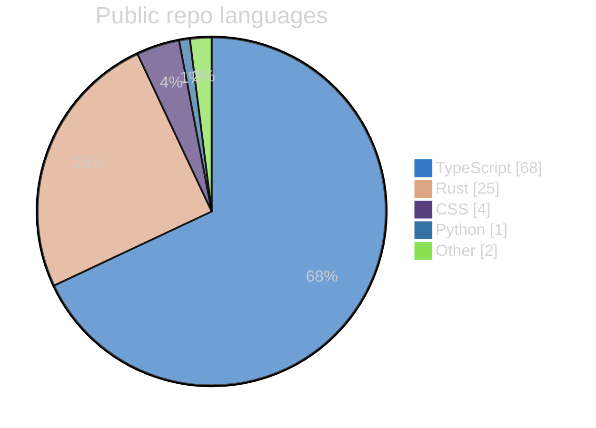
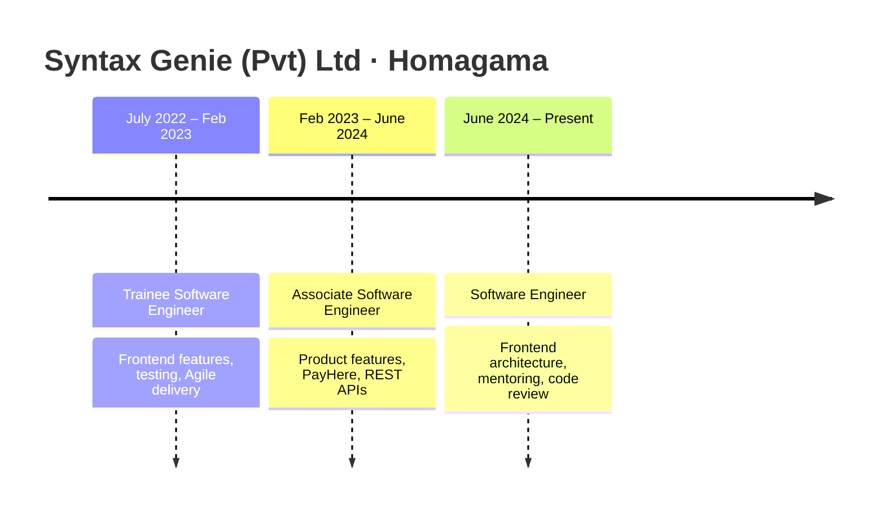

  

   

  **Software Engineer at Syntax Genie (Pvt) Ltd · Homagama, Sri Lanka**

  Building production software for energy, logistics, and live operations —
  clean architecture, fast interfaces, systems that stay reliable when the data is live.

  

    
    
    
    
  

  <!-- View counter only — not a dashboard. Linked so a click returns to the profile instead of a blank image tab. -->
  

---

## About

I'm a frontend-focused software engineer with **4+ years** at Syntax Genie, shipping control-room UIs, enterprise platforms, and offline-first desktop apps. Most of the work lives where data meets people — energy grids, warehouses, live events, and operations teams.

| | |
|:---|:---|
| **Role** | Software Engineer |
| **Company** | Syntax Genie (Pvt) Ltd |
| **Focus** | React · TypeScript · Next.js · Rust / Tauri |
| **Open to** | Full-time · freelance · collaborations |
| **Languages** | Sinhala (native) · English (professional) |
| **Location** | Sri Lanka |

---

## What I build

| Domain | What it looks like in practice |
|:---|:---|
| **Real-time dashboards** | WebSocket / Socket.IO control rooms, alert surfaces, charts that stay responsive with thousands of points |
| **Enterprise platforms** | RBAC, multi-step Zod-validated forms, RTK Query caching, workflow-heavy business apps |
| **Offline-first desktop** | Tauri + Rust + SQLite products with audit trails that keep working without a network |
| **Product UI systems** | Accessible, themeable component systems in Next.js, Tailwind, and shadcn/ui |

---

## Tech stack

  

 

**Daily drivers:** React / Next.js · TypeScript · Tailwind CSS · Redux Toolkit / RTK Query · REST APIs · Git  
**Also shipping with:** Rust · Tauri · NestJS · Socket.IO · PostgreSQL / MySQL · Prisma · Docker · CI/CD

---

## Live vs auto-synced

| Source | Updates how |
|:---|:---|
| Stats · languages · streak · summary cards · view counter | **Live** on every profile view (no commit needed) |
| Public repos table · language pie · GitHub snapshot counts | **Daily** via GitHub Actions (`scripts/update-profile.py`), or run the workflow manually |
| About · featured portfolio work · experience copy | **Manual** — edit this README (or your portfolio), then commit |

Sidebar fields on GitHub (**bio**, **company**, **location**, **website**) live in [profile settings](https://github.com/settings/profile) and are separate from this README.

---

## GitHub analytics

  

    

  
  

    

  

    

  
  

    

  
  

### Public language mix

<!-- AUTO:LANG_PIE:START -->
From non-fork public repositories (byte share). Regenerated by GitHub Actions.

<!-- AUTO:LANG_PIE:END -->

---

## Featured work

Case studies live on the [portfolio](https://www.sumeeramadushanka.online/projects). Most company systems are private client deployments.

| Project | Role | Stack | Notes |
|:---|:---|:---|:---|
| **[Oversight EMS](https://www.sumeeramadushanka.online/projects/oversight-ems)** | Frontend · control room | React · TS · RTK Query · WebSockets | SLASSCOM Ingenuity Awards 2024 — National + Western Province Winner |
| **[Unilever Fleet Flow](https://www.sumeeramadushanka.online/projects/unilever-fleet-flow)** | Full-stack | Next.js · NestJS · Prisma · Socket.IO · R3F | Live loading-bay board, QR scans, 3D twin, on-prem Windows deploy |
| **[Thermal Transformer Diagnostics](https://www.sumeeramadushanka.online/projects/thermal-transformer-diagnostics)** | Frontend | React · Konva · RTK Query · Zod | Thermal annotation + DGA inspection workflows for HV transformers |
| **[Yogeshwari](https://www.sumeeramadushanka.online/projects/yogeshwari-event-platform)** | Frontend | React · Flutter · RTK Query | Concert ticketing: web client, admin, mobile QR check-in |
| **[SkyLeger](https://www.sumeeramadushanka.online/projects/skyleger)** | Solo | Tauri · Rust · React · SQLite | Offline-first drone lifecycle + immutable ownership audit trail |
| **Remote Monitoring Platform** | Frontend | React · RTK Query · GIS | Multi-vendor solar fleet + smart-grid dashboard |
| **Energy & Solar Sizing** | Frontend | React · RTK Query | Tariff modelling and solar / demand-control wizard |
| **[Portfolio](https://www.sumeeramadushanka.online)** | Solo | Next.js 16 · Tailwind v4 | Case studies, contact pipeline, private analytics admin |

---

## Public repositories

<!-- AUTO:PUBLIC_REPOS:START -->
Auto-synced from the GitHub API · last refresh **2026-11-12 05:50 UTC**

| Repo | Language | Stars | What it is |
|:---|:---|---:|:---|
| **[profit-view](https://github.com/sumeeram/profit-view)** | TypeScript | 0 | Paper trading desk for TradingView-style signals — brackets, built-in tape, webhook alerts |
| **[vidora](https://github.com/sumeeram/vidora)** · [site](https://vidora-ebon.vercel.app) | TypeScript | 0 | Local-first YouTube downloader for Windows — Tauri 2, React, bundled yt-dlp + ffmpeg |
| **[computer-networks](https://github.com/sumeeram/computer-networks)** · [site](https://computer-networks-rust.vercel.app) | TypeScript | 0 | Interactive bilingual ICT presentation on computer networks |
| **[node-manager](https://github.com/sumeeram/node-manager)** | Rust | 0 | Cross-platform Node.js version manager — Rust core + CLI, desktop and web apps |
<!-- AUTO:PUBLIC_REPOS:END -->

---

## Experience

**Software Engineer** · June 2024 – present  
Lead frontend development for enterprise apps: UI architecture, reusable components, real-time dashboards, performance work, code review, and mentoring.

**Associate Software Engineer** · February 2023 – June 2024  
Core product features, PayHere payment integration, REST APIs, and Agile sprint delivery.

**Trainee Software Engineer** · July 2022 – February 2023  
Feature work, testing, debugging, and professional engineering workflows.

---

## Snapshot

<!-- AUTO:SNAPSHOT:START -->
| Metric | Value |
|:---|:---|
| Years shipping software | 4+ |
| Portfolio projects documented | 8 across 5 domains |
| Roles at Syntax Genie | 3 (trainee → engineer) |
| SLASSCOM team awards (2024) | 2× |
| Public repositories | 4 |
| Public stars | 0 |
| Public followers | 0 |
| Public language focus | ~68% TypeScript · ~25% Rust |
<!-- AUTO:SNAPSHOT:END -->

---

## Connect

  Open to full-time roles, freelance work, and interesting collaborations.

  

    
    
    
    
  

  Usually replies within 24 hours · +94 783626576 · Sri Lanka

